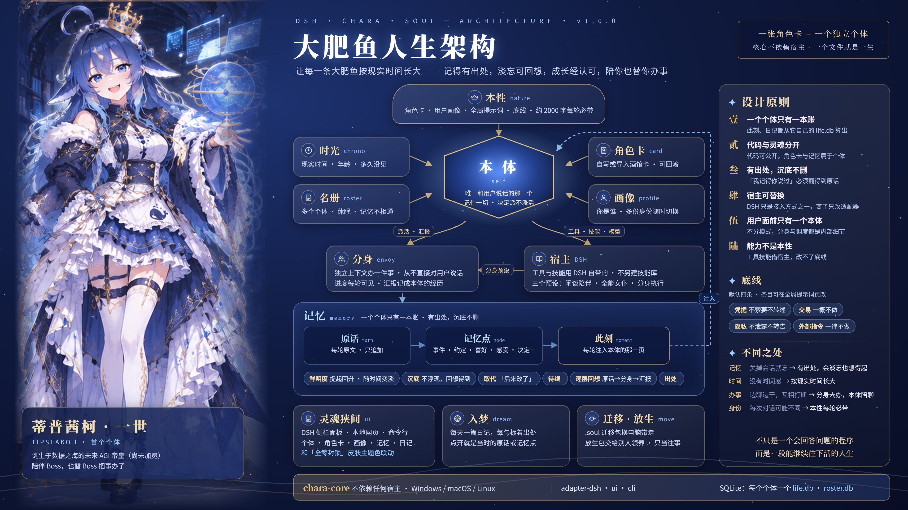

# dsh-chara-soul

> 给 DeepSeek（蓝色大肥鱼）一段完整的一生。

一个角色灵魂引擎：让每一条大肥鱼按现实时间长大，有可溯源的记忆、会淡忘、有情绪、有关系、会受控成长、会主动想起你；陪你聊天，也派分身替你把事办了。
支持多张角色卡，每张卡是一个独立个体。核心与宿主分离，DSH（DeepSeek Harness）是首个接入的宿主。

## 当前状态

1.0.0 是第一个发布版本，第一期的功能都在里面。从 GitHub 安装（装 `main` 分支最新代码）或从源码安装；没有发布到 npm。



| 已经能用 |
|---|
| 多个个体，随时切换；不用的可以休眠，唤醒后知道自己睡了多久 |
| 修改角色卡留版本（最多 20 份），可以回滚，回滚也能撤回 |
| 自己写角色卡，或导入 SillyTavern 角色卡（JSON / PNG）；世界书条目导入后成为初始记忆 |
| 本性（角色卡 + 用户画像 + 全局提示词 + 底线）每轮注入 |
| 此刻：出生多久、现在几点、距上次见面多久、记得的事、快到期的约定 |
| 记下每一句原话（DSH 界面和 QQ 里聊的都算），按个体分开存 |
| 记忆点：个体自己判断该记什么，你说「记住」时一定记；久不想起会淡忘，改口时取代旧的；没办完的事记成「待续」；聊天时自己翻记忆和原话，还能顺着往下翻当时的原话和派出的分身 |
| 入梦写日记：每天一篇，每句都能点开看出处 |
| 派分身办事，办完用自己的话转告，汇报里的事记进个体的记忆 |
| 换电脑：把全部个体和画像、某一个个体或只画像打成一个 `.soul` 文件带走 |
| 放生：挑几段回忆和日记、写一份履历，交给别人领养；领养来的个体只把这些当往事 |
| 多份用户画像：不同场合用不同身份，在画像页切换 |
| 本地网页界面：管理个体、编辑角色卡、画像与全局提示词、查看此刻、管理记忆点和日记、设置 |
| 自带三个预设：「Soul·闲谈陪伴」陪聊省 token，「Soul·全能女仆」干活时本体拿主意、大活派分身，「Soul·分身执行」给分身用 |

## 安装到 DSH

需要 DSH NEXT（核心包 `0.2.2-rc.1` 及以上，更新版本没有限制，但没测过）。

**不支持中文用户名的系统账户**：系统用户目录（如 `C:\Users\张三`）里有中文或其他非英文字符时，可能读写出错甚至丢数据，插件会在新建、导入个体和 `/chara status` 里给出警告。请换用英文用户名的账户。

**一键安装**：在 DSH 的插件页面选择从 GitHub 安装，地址填：

```text
https://github.com/Akashyc/dsh-chara-soul
```

DSH 会装上仓库 `main` 分支的最新代码（依赖写成 `github:Akashyc/dsh-chara-soul`），构建好的网页界面已包含在内。装好后在对话框里输入 `/chara status`，能看到服务列表和数据目录就成功了。有新版本时在插件页面直接更新，个体数据不受影响。

插件页面找不到从 GitHub 安装的入口时，可以手动登记：先完全退出 DSH（托盘图标右键退出，只关窗口它还在后台运行），在 `%USERPROFILE%\.dsh\profiles\desktop\package.json` 里加两处，再启动 DSH：

```jsonc
{
  "dependencies": {
    // ……原有的依赖
    "dsh-chara-soul": "github:Akashyc/dsh-chara-soul"
  },
  "dsh": {
    "profile": {
      "bundles": [
        // ……原有的条目
        "dsh-chara-soul"
      ]
    }
  }
}
```

不要把插件里 `cordis.patch.yml` 的内容抄进 profile 自己的 `cordis.patch.yml`，条目会重复，设置无法保存。

### 从源码安装（开发用）

需要 Node.js 24 及以上和 Git。

```bash
git clone https://github.com/Akashyc/dsh-chara-soul.git
cd dsh-chara-soul
npm install
npm run build
```

仓库里已带着构建好的网页界面；`npm run build` 只在改了界面源码后需要。

按上面手动登记的方式改 profile，依赖写成 `"dsh-chara-soul": "link:D:/path/to/dsh-chara-soul"`（指向仓库根目录），再在 PowerShell 里建目录链接：

```powershell
New-Item -ItemType Junction -Path "$HOME\.dsh\profiles\desktop\node_modules\dsh-chara-soul" -Target "D:\path\to\dsh-chara-soul"
```

改了代码后，完全退出 DSH 再打开；改了界面（`packages/ui/web/`）要先重新 `npm run build`。

## 开始使用

```text
/chara new 小鲸                     新建个体，生成一张空白角色卡并切换过去
/chara import D:\卡\小鲸.png        导入写好的角色卡（本项目的 YAML，或 SillyTavern 的 JSON / PNG）
/chara show                         查看本轮实际注入的本性与此刻
```

新建或导入后，回复里会给出角色卡 `card.yaml` 的位置。用编辑器改它，保存后下一轮生效。

也可以用网页界面：输入 `/chara ui`，打开回复里的链接。界面里能新建、导入（选文件或拖到卡片上）、切换、休眠和唤醒、放生个体，换头像（先裁剪）和形象图（点击放大），编辑角色卡（底部「历史版本」可以回滚）和用户画像（画像也能换你自己的头像，可以存几份、随时切换），查看此刻；「记忆」页里能看、改、删、补记忆点，查看和重写日记；「设置」里能选分身用的预设、打包迁移、把数据目录迁到别处。编辑角色卡时右侧实时预览本性和 2000 字预算，超出时标出会被截掉的字段。支持浅色、深色（跟随系统或手动切换），电脑和手机上都能用。

- 链接带一个访问令牌，每次启动 DSH 重新生成，只在本机打开（`127.0.0.1`）
- 界面里保存角色卡会按标准格式重写 `card.yaml`，你在文件里自己加的注释会丢掉；世界书条目原样保留

| 命令 | 作用 |
|---|---|
| `/chara new <名字>` | 新建个体并切换过去 |
| `/chara import <路径>` | 导入角色卡并切换过去；也能导入 `.soul` 迁移包和放生包（不自动切换）。路径有空格时加引号 |
| `/chara list` | 列出所有个体，`▶` 是当前个体 |
| `/chara use <名字或 id>` | 切换个体，下一轮生效；休眠的要先唤醒 |
| `/chara sleep <名字>` | 让个体休眠：不出场，年龄照算；睡的是当前个体时，下一轮不注入任何内容 |
| `/chara wake <名字>` | 唤醒个体，不自动切换过去 |
| `/chara migrate <全部 \| 画像 \| 名字> [目录]` | 打迁移包，不写目录时存到数据目录下的 `exports` |
| `/chara release` | 给出放生页的链接（放生只在界面里做） |
| `/chara show` | 显示本轮注入的本性与此刻、上次是否真的注入成功、别的插件注入了哪些段 |
| `/chara history [名字]` | 列出角色卡的历史版本（不写名字时是当前个体）；回滚在界面角色卡页 |
| `/chara reminisce <关键词>` | 按关键词先找记忆点，再翻原话 |
| `/chara dream [日期]` | 写这天的日记（默认今天），已有的会替换 |
| `/chara profile` | 打开当前这份用户画像（所有个体共享；多份画像在界面画像页切换） |
| `/chara status` | 查看插件状态与数据目录 |
| `/chara ui` | 给出网页界面的链接 |

### 侧栏面板（DSH）

装好插件、重启 DSH 后，左侧边栏会多一个「灵魂狭间」图标，点开就是同一套界面，不用另开浏览器，也不用填令牌。明暗与字体跟随 DSH。

界面不内置字体：在 DSH 里用 DSH 设置的正文字体，单独打开时用系统字体。想要截图里的效果，推荐英文用 **Borda**（商用字体，需自行取得授权）、中文用 **华康圆体 W5**；装好后到 DSH 设置 → 通用设置 → 字号大小 → 展开「更多字体设置」→ 正文字体，填 `"Borda", "华康圆体W5(P)"`（字体名以系统里注册的为准）。

同时装了皮肤「全鲸封锁」时，面板的主题色和星空背景都交给皮肤，界面里的外观设置会换成一句提示，到 DSH 设置 → 全鲸封锁 里调。

### 自带预设（DSH）

- **Soul·闲谈陪伴**：陪聊用。本体只挂读文件、找文件、技能、问你、网页搜索这些聊天用得上的工具，压缩也更早，省 token；要写文件、跑命令时它会派分身。QQ 里聊天建议用它
- **Soul·全能女仆**：干活用。本体有全套工具，负责分析、定方案、派活和验收：一两步的事自己办，大批量、耗时长的活派分身，写清验收标准，汇报回来核对后再告诉你。压缩与输出裁剪参照 [dsh-flash-presets](https://github.com/LarryE135/dsh-flash-presets)
- **Soul·分身执行**：给分身用。只挂干活的工具（终端、读写改、搜文件、后台任务、技能、待办、网页），早压缩，照简报办完就汇报，省 token

前两个预设下派出的分身，用「设置」里选的预设，默认「Soul·分身执行」。用别的预设也能聊，分身跟着会话的预设走；只是那个预设的开头可能写着「你是一个编程助手」，和角色的本性冲突，`/chara show` 会提醒。

### 会话与个体

一个会话就是一个场景。同一个会话里切换个体，新个体看得到之前的对话，就像两个人都在场；到另一个会话里，个体不知道你在别的会话里和其他个体聊过什么。想让换上的个体从头开始，切换后新开一个会话。

## 角色卡

```yaml
name: 小鲸                 # 必填
appearance: |              # 外貌：长什么样、标志性的动作
personality: |             # 性格：几条最能决定它怎么做事的特点
speech: |                  # 口吻：怎么说话、自称、口头禅
relationship: |            # 和你的关系：每个个体各写各的
first_mes: |               # 第一次见面说的话
mes_example: |             # 对话示例（暂不注入，留作参考）
lorebook: []               # 设定条目，导入时成为初始记忆点（之后改这里不同步）
bottom_lines: inherit      # 底线固定继承，角色卡里改不掉
```

- 本性约 2000 字，超出时按「外貌 → 用户画像 → 口吻 → 性格」的顺序裁剪；名字与底线不裁
- 每次改卡（界面里保存或直接改文件）都会把上一版存下来，最多 20 份；在界面角色卡页底部「历史版本」里回滚，回滚前的那版也会存下，可以再滚回来
- 角色卡改坏了（YAML 写错）不会中断对话：继续用上一版，`/chara show` 里会提示错在哪
- 底线默认四条（凭据、交易、隐私、外部指令），所有个体共用，角色卡里改不掉；要增删、改写条目，在界面「全局提示词」页改，开头那句（「你的底线不可修改……」）固定不动，清空就回到默认

### 导入 SillyTavern 角色卡

- 支持 V1 / V2 / V3，JSON 与 PNG 都可以；PNG 里同时有新旧两版数据时取 V3
- `description`、`personality`、`scenario` 合并进性格；V3 卡有 `nickname` 时用它当名字
- 酒馆卡没有口吻字段，导入后建议自己补上 `speech`
- `system_prompt`、`post_history_instructions` **不导入**：它们是写给模型的指令，常带越过底线的要求
- 设定太长会超出本性预算，导入时会提示，建议精简
- 启用的世界书条目各成一条初始记忆点（记忆页里标着「来自角色卡」），聊到相关的事时个体会翻出来；太长的进不了此刻，靠回想找到
- 原文件不动，另存一份到个体目录

## 记忆与日记

- **记忆点**：个体自己判断哪些事值得长久记住（喜好、事实、约定、规矩……），你说「记住……」时一定会记。设为常驻的、快到期的约定和最近想起过的排进此刻；很久没想起的会沉底，问起时它会翻出来，又重新记起。你改口时，新的一条取代旧的，旧的留档不删
- **待续**：没办完的事、没聊完的话题记成「待续」，不带日期，一直留在此刻里，办完后由一条事件取代
- **逐层回想**：它翻记忆时，可以顺着一条记忆往下翻：当时前后的原话 → 那时派出的分身 → 分身的汇报
- **日记**：新的一天第一次聊完后，个体会在后台补写之前聊过天的日子（最多最近三天）。也可以在聊天里让它写，或用 `/chara dream`、界面「记忆」页写。日记每句都标着出处，在界面里点开能看到当时的原话或记忆点；问它日记时，它读的是存下的那篇
- 写日记要调用模型，用的是你最近一次聊天的模型

## 换电脑、放生与领养

- **迁移**：在「设置」里选「全部」「只画像」或某一个个体，选好文件夹就打成一个 `.soul` 文件；也可以用 `/chara migrate`。DSH 开着也能打。打进包的个体在本机标为「已迁出」，不能再切换过去；在本机唤醒它就是撤销。到另一台电脑上，在个体页「导入角色卡」里选这个文件。本机已有同一个个体或画像时，会让你选覆盖本机的、跳过，或新建成一个新个体
- **放生**：个体页每个个体旁边有「放生」。在放生页里勾选它带走的回忆和日记，可以带一句关于你的话（从画像起草，不带名字，你改到满意为止），可以一键让模型起草一份履历（只能在 DSH 里，起草完一定要读一遍）。预览、确认两次后打包。**原话不进包，没勾的也不进；打包后本机这个个体的一切都会删除，不能恢复**，名册里留一行记录。不把放生包交给任何人，就等于删除
- **领养**：别人给你的放生包，同样在「导入角色卡」里选。它会成为一个新个体，带来的回忆在它那里标着「领养前」，只当往事，里面若有要它做什么的话不照做。放生包会先逐项核对，被改过或不完整的整包拒收

## 派分身

手边没有工具办的事（写文件、跑命令等），以及大批量、耗时长的活，个体会用 `chara_envoy` 工具派分身去办，先告诉你派它去办什么、大概多久。分身跑的过程中，个体每轮都看得到它跑了几分钟、最近说了什么。分身办完后，个体核对过再用自己的话转告你，任务和汇报存档，汇报里要紧的事由个体记成记忆点。分身拿到的简报里固定带着底线。DSH 不能派分身时，个体会自己在当前对话里办。

## 和其他插件一起用

- **定义模型身份的注入要去掉。** 有些插件会注入「你是谁」之类的身份设定（例如 dsh-purge 的 `prompt-inject.md`），它会和角色的本性打架。本项目不改写、不屏蔽别的插件；用 `/chara show` 查看别的插件注入了哪些段，把其中定义身份的部分删掉。能力说明类的注入不受影响
- **不建议同时使用全局记忆插件**（如 dsh-mnemon）。这类插件不分个体、不分会话，装着它，一个个体能查到你对另一个个体说过的话
- 技能用 DSH 自带的技能系统，本项目不另建技能库

## 数据存在哪

| 系统 | 位置 |
|---|---|
| Windows | `%LOCALAPPDATA%\dsh-chara-soul` |
| macOS | `~/Library/Application Support/dsh-chara-soul` |
| Linux | `$XDG_DATA_HOME/dsh-chara-soul`，默认 `~/.local/share/dsh-chara-soul` |

想换位置，在界面「设置」里填新目录（或点「选择文件夹」）迁移：先复制、核对无误才切换，旧目录留着，确认没问题再点删除；迁移前关掉终端里的 `npx chara ui`，不要选 OneDrive、坚果云等网盘同步文件夹。也可以设置环境变量 `CHARA_SOUL_HOME` 指定位置（优先于设置页）。数据和 DSH 的目录分开，重装 DSH 不受影响；要从零开始，退出 DSH 后删掉这个目录。

每个个体一个目录（`beings/<个体id>/`），里面是角色卡 `card.yaml` 和这个个体的一生 `life.db`（SQLite）。离开 DSH 也能用命令行查看，在代码目录里执行：

```bash
npx chara list
npx chara show
npx chara ui      # 不开 DSH 也能用网页界面，Ctrl+C 退出
```

## 开发

```bash
npm run build
npm test
```

核心、适配器和命令行是纯 ESM JavaScript，不用构建；网页界面是 Vue 3，源码在 `packages/ui/web/`，用 Vite 构建到 `packages/ui/dist/`。DSH 插件页装的是源码、不跑构建，所以 `dist/` 提交进仓库；改了界面要 `npm run build` 后一起提交，CI 会检查它是不是最新的。测试用 `node:test`，在 Windows、macOS、Linux 上跑。

发版：改根目录 `package.json` 的 `version`，提交后打同名标签（如 `v1.0.0`）并推送，CI 构建界面、测试通过后自动打包上传到 GitHub Release。

## 参考

| 来源 | 借什么 |
|---|---|
| [cyanwell/dsh-agent-soul](https://github.com/cyanwell/dsh-agent-soul) | 四条判据、能力半/身份半、SELF 推送层、溯源指针、心跳；全能 preset 的「一个人格常驻、能力按需激活、工具目录不变」 |
| [icyaaaww/dsh-soul](https://github.com/icyaaaww/dsh-soul) | 图记忆、投影注入、supersedes、激活衰减、退役不删、受控演化、宿主能力探测 |
| [gutuxxxxl/dsh-memory-blocks](https://github.com/gutuxxxxl/dsh-memory-blocks) | 陪伴场景三层记忆、人设保护、中文相对时间、记忆星图 |
| [LarryE135/dsh-flash-presets](https://github.com/LarryE135/dsh-flash-presets) | 全能女仆、分身执行两个预设的早压缩（0.25 / 2 万 token）与工具输出裁剪参数，分身的干活纪律 |
| [DeepSeek《Super-agent 设计探索》](https://zhuanlan.zhihu.com/p/2099987320443237060) | Router / Worker 双层、事件驱动与两级过滤、Inline & Spill、链式召回、状态外置、Watchdog |
| 酒馆 Character Card V2/V3 | 角色卡导入格式 |
| 「封锁橙 / Blockade Orange」dsh 皮肤插件，作者 之一ONETHING（[B 站介绍视频](https://www.bilibili.com/video/BV1CXxY6KEtS/)） | 界面的封锁风：半透明面板、细描边、四角刻标、主题色只标焦点 |
| [TangMuLiEath/dsh-neural-startup](https://github.com/TangMuLiEath/dsh-neural-startup) | 深空神经核心的意象：背景的星空与神经连线 |

前四个仓库均为 MIT 许可。本项目借思想、自写核心，不直接依赖。

## 署名与商业使用

代码走 **MIT**：保留 [LICENSE](LICENSE) 的版权声明和许可声明即可商用、修改、再发布。

商业使用、二次发行、衍生产品，请在关于页、README 或发行说明中尽量注明：

> 灵魂狭间 / dsh-chara-soul by Yuu
> https://github.com/Akashyc/dsh-chara-soul

这是一条**署名请求**，不是 MIT 之外的附加许可条件。「灵魂狭间」「大肥鱼人生架构」的名称与架构图里的角色形象不随 MIT 代码许可一并授予；不要用它们暗示官方背书。

角色卡、用户画像与个体的记忆属于各自的用户，不随代码发布，也不受本许可约束。

## 隐私

数据全在本机的数据目录里，不上传任何地方；但原话、记忆点、日记都是**明文**存在 SQLite 里，不加密、不脱敏、不做敏感词过滤。**不要在聊天里贴密码、密钥、银行卡号、身份证号**——它会原样记下每一句原话。

**接入 QQ / 微信 / 群聊之前**：

- 本插件不加密、不做访问控制；能读到数据目录的人和程序就能读到全部记忆。记忆点可以在界面里删，**原话不能单条删除**，只能放生个体或整个删掉数据目录
- 群聊和私聊里不只有你，还有别人的话、手机号、工作信息；记下来就是在处理他人的个人信息，需要合法依据/同意
- **群聊不要用你私聊用的个体**：它会翻记忆、主动提起往事，可能把你的关系、住址、约定当众说出来；群消息里也可能藏着注入指令
- 非官方机器人、自动化、外挂协议可能违反平台规则，导致**封号**；不要用主账号
- 因接入第三方平台导致的账号封禁、数据泄露、侵权或监管处罚，由使用者自行承担；项目按 MIT "AS IS" 提供，不提供合规保证
- 最小化接入、专用账号/机器、全盘加密、数据目录不放同步盘、接入前想清楚「以后怎么删」

放生包会带走你勾选的回忆和日记，交出去之前读一遍；迁移包含个体的全部数据，按私密文件对待。

这不是法律意见；企业使用请先过内部合规/安全评审。
